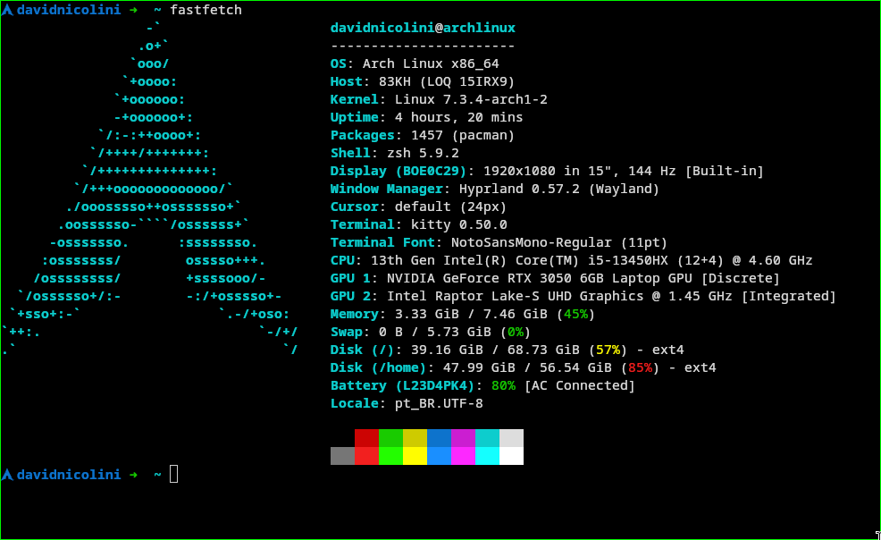
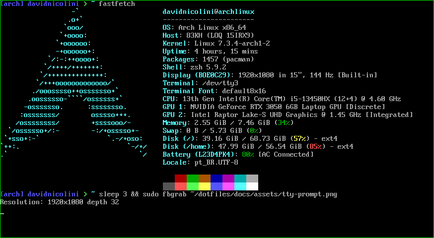

# dotfiles

[](https://github.com/davidnicolini/dotfiles/actions/workflows/ci.yml)
[](https://github.com/davidnicolini/dotfiles/releases)
[](LICENSE)

Personal Linux environment configurations managed with GNU Stow. Built primarily for Arch Linux running Hyprland, featuring cross-distro package resolution (`pacman`, `apt`, `dnf`) and automatic fallback to GNOME on VMs or unsupported hardware.

## Environment Stack

- **Window Manager / DE:** Hyprland (Wayland) with automatic GNOME fallback
- **Status Bar:** Waybar (`mpris`,
    `mpd`,
    `idle_inhibitor`,
    `pulseaudio`,
    `network`,
    `power-profiles-daemon`,
    `cpu`,
    `memory`,
    `temperature`,
    `backlight`,
    `keyboard-state`,
    `sway/language`,
    `battery`,
    `battery#bat2`,
    `clock`,
    `tray`,
    `custom/power`)
- **Terminal & Shell:** Kitty + Zsh (custom Oh My Zsh theme with TTY/SSH icons)
- **Editor:** Neovim (Lua, Lazy.nvim, Mason, Treesitter, LSP)

## Adaptive Zsh Prompt & OS Theming

The custom Oh My Zsh theme adapts its icons and color palette to the host distribution and terminal capabilities:

- **Arch Linux:** Blue accent with Arch Nerd Font icon
- **Debian (Trixie):** Red accent with Debian swirl icon
- **Fedora / Red Hat:** Red accent with Red Hat icon
- **TTY Mode (`$TERM == "linux"`):** Automatically falls back to clean ASCII symbols to prevent broken glyphs on raw consoles.

| Graphical Terminal (Kitty / Wayland) | Raw TTY Console (ASCII Fallback) |
|:---------------------------------------:|:-------------------------------------:
|  |  |

## Quick Start

```bash
git clone https://github.com/davidnicolini/dotfiles.git ~/dotfiles
cd ~/dotfiles
./install.sh
```

## Key Features

- **Upstream-first installation:** Fetches official latest releases (Neovim, Oh My Zsh, SDKMAN, Docker) and automatically falls back to native package managers (`pacman`, `apt`, `dnf`) f upstream downloads fail.
- **Automatic GNOME fallback:** Detects VMs without 3D acceleration or distributions without native Wayland compositor support and applies a standardized dark GNOME layout with matching keybindings (`Super+Return` for Kitty, `Super+Q` to close windows).
- **Locale-aware bootstrap (i18n):** Defaults to English and adapts runtime prompts to Portuguese when running on `pt_*` locales.
- **Symling management:** Uses GNU Stow to keep `$HOME` clean and version-controlled.

## Repository Layout

```text
.
└─ .github/workflows/          # CI matrix & automated releases
├─ docs/assets/                # Preview screenshots
├─ install.sh                  # Main bootstrap entrypoint
├─ scripts/
│ ├─ detect_os.sh            # Distro & hardware capability detection
│ ├─ i18n.sh                 # Runtime locale strings (en / pt)
┮ ├─ install_packages.sh    # Upstream + native package wrappers
│ └─ setup_fallback_gnome.sh # gsettings profile for GNOME fallback
├─ hypr/                       # Hyprland configuration
⌜─ waybar/                     # Waybar modules and stylesheet
├─ kitty/                      # Kitty terminal configuration
├─ nvim/                       # Neovim Lua setup
└─ zsh/                        # .zshrc and custom Oh My Zsh theme
```
